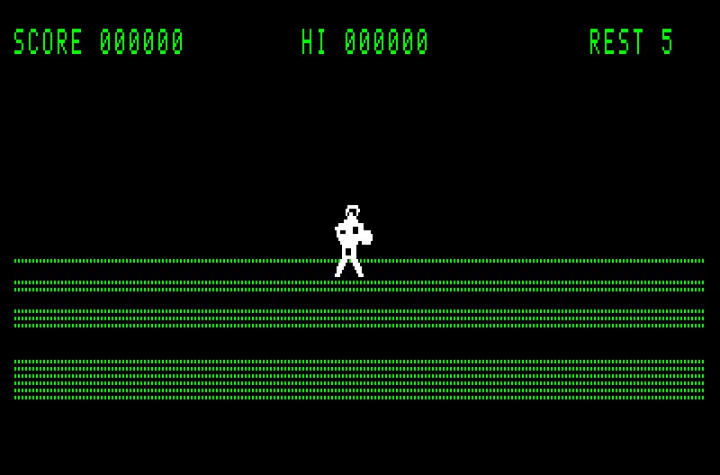
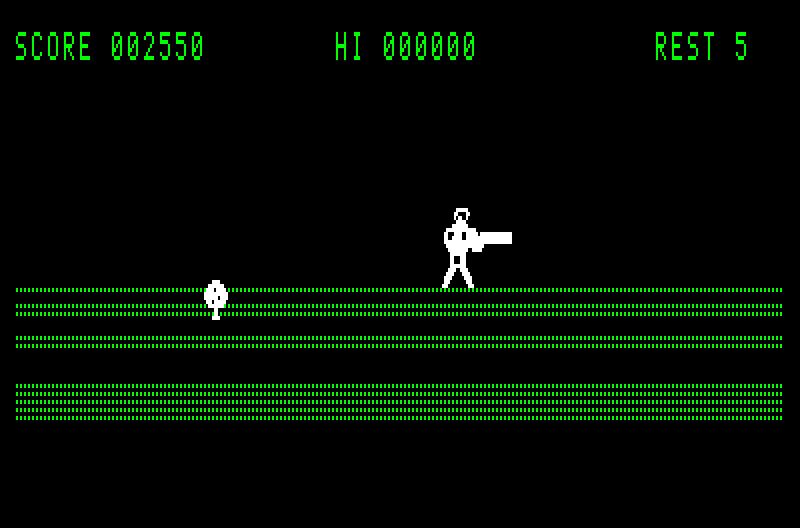
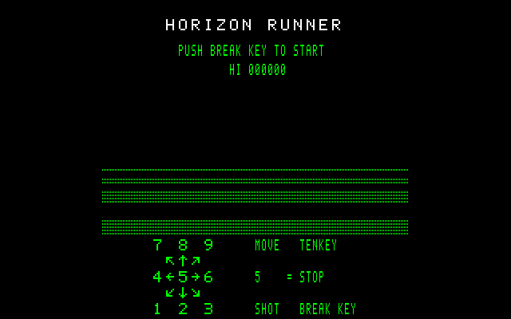
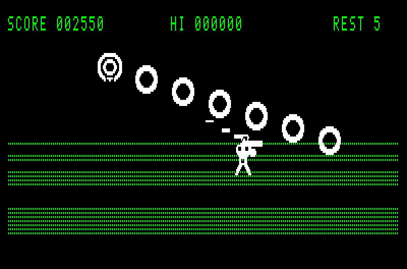
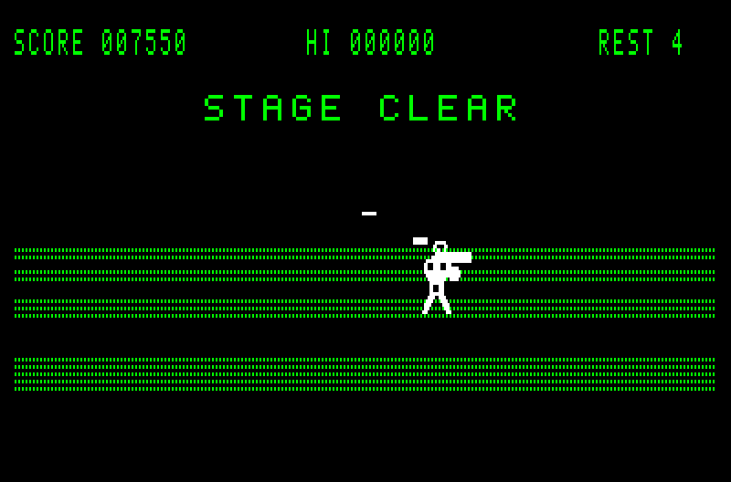
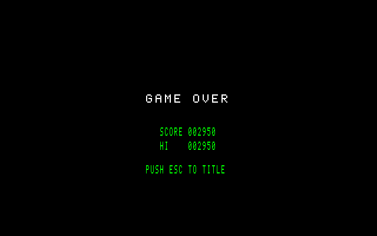

# HorizonRunner

初代 FM-7 向けの擬似 3D シューティングゲームです。
流れる床の上を奥へ向かって飛び、迫り来る敵弾をかわし、敵や岩を撃ち落としながら、ステージの最後に出るボスを倒します。

| ステージの途中 | ボス戦 |
|---|---|
|  |  |

| タイトル | ボス |
|---|---|
|  |  |
| **ステージクリア** | **ゲームオーバー** |
|  |  |

音付きの動画: [ステージの途中 (MP4)](docs/media/gameplay.mp4) / [ボス戦 (MP4)](docs/media/boss.mp4)

## 遊び方

ディスクで遊ぶ時は、`disks/horizonrunner.d77` をドライブ 0 に入れて起動します。
テープで遊ぶ時は、`disks/horizonrunner.t77` (テープイメージ) か `disks/horizonrunner.wav` (カセットの入力へ流す音声) を用意し、F-BASIC で `RUN "CAS0:"` を入力して読み込みます。
タイトル画面で BREAK か RETURN を押すと始まります。
テンキーで動き、BREAK キーでショットを撃ちます。
ゲームオーバーの画面では ESC キーでタイトルへ戻れます。
起動の手順と操作の詳細は [docs/PLAY.md](docs/PLAY.md) にあります。

## ビルド

cmoc、lwasm / lwlink、python3、GNU Make を用意し、`make` を実行すると `disks/` の配布物ができます。
必要なツールのバージョン、ターゲットの一覧、テープイメージへの変換は [docs/BUILD.md](docs/BUILD.md) にあります。

## 配布物 (disks/)

| ファイル | 中身 |
|---|---|
| `disks/horizonrunner.d77` | ディスクイメージ |
| `disks/horizonrunner.t77` | カセットテープ (CMT) イメージ |
| `disks/horizonrunner.wav` | カセットの入力へ流す音声 |
| `disks/horizonrunner.cmt.txt` | テープからのロード手順 |

## ドキュメント

| 文書 | 中身 |
|---|---|
| [docs/PLAY.md](docs/PLAY.md) | ディスク・テープ・WAV からの起動の手順、操作、ゲームの流れ |
| [docs/BUILD.md](docs/BUILD.md) | ビルドの手順、make のターゲット、D77 から T77 / WAV への変換 |
| [docs/ARCHITECTURE.md](docs/ARCHITECTURE.md) | 全体の実装の解説 (起動の流れ、メモリマップ、メイン CPU とサブ CPU のやり取り、メインループ、各モジュール、ビルドの流れ) |
| [docs/RENDER.md](docs/RENDER.md) | 描画の仕組み (プレーンの使い方、ダブルバッファリング、VRAM への書き込み) |
| [CHANGELOG.md](CHANGELOG.md) | 変更の履歴 |

## ライセンス

MIT License (Copyright (c) 2026 Naomitsu Tsugiiwa)。
全文は [LICENSE](LICENSE)。
`scripts/d77_to_t77_chunks.py` は MIT License のテープ変換ツール D77TOT77WAV を取り込んだもので、そのライセンスの全文は [scripts/D77TOT77WAV.LICENSE.txt](scripts/D77TOT77WAV.LICENSE.txt) にあります。

本文中の機種名等は互換性の説明のために記載しており、各権利者との提携・承認関係はありません。
