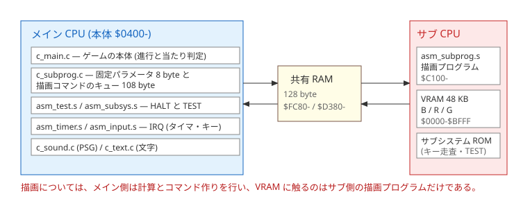
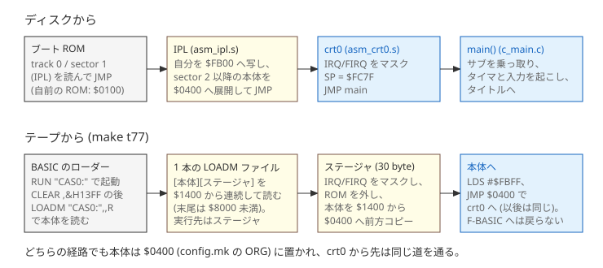
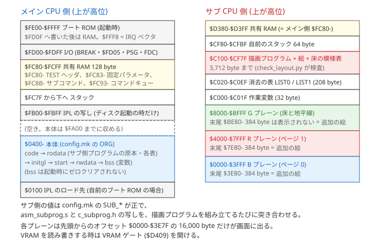
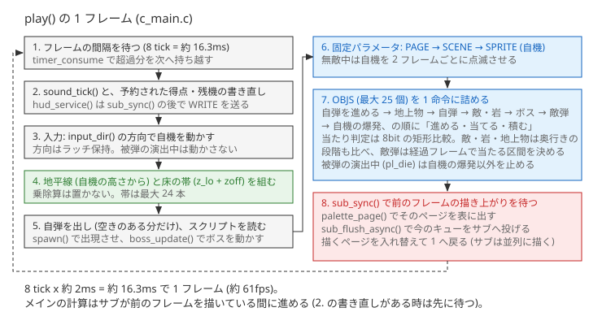

# HorizonRunner — 全体の実装

この文書は、HorizonRunner の全体の作り (起動の流れ、メモリの使い方、メイン CPU とサブ CPU のやり取り、メインループ、各モジュール、ビルドの流れ) を説明する。
ソースを読む前の地図であり、各節の図の下に、関係するアドレスとソースの入口を示す。
ファイルごとの役割と主な関数名は末尾の「付録: ファイルの一覧」にまとめた。
描画の詳しい仕組み (プレーン、ダブルバッファリング、消去、VRAM への書き込み) は [RENDER.md](RENDER.md) を参照のこと。
ビルドのコマンドと必要なツールは [BUILD.md](BUILD.md) に、起動と操作は [PLAY.md](PLAY.md) にある。

アドレスと値は `$0400` のように `$` を付けて 16 進で書く。

## 1. 全体の構成

メイン CPU はゲームの計算とコマンド作りだけを行い、サブ CPU に載せた自前の描画プログラムが VRAM (画面のメモリ。サブ CPU 側にある) へ書く。
描画用のパラメータとコマンドは 128 byte の共有 RAM で渡す (メイン CPU はこのほかに `$FD05` でサブ CPU を止めたり動かしたりし、`$FD01` でキーコードを受け取る)。

- **メイン CPU 側** — C (CMOC) とアセンブラ (lwasm) で書き、1 つの本体 `build/horizonrunner.bin` にリンクする。ゲームの進行、当たり判定、入力、音、文字の描画のコマンド作りを受け持つ。
- **サブ CPU 側** — 描画プログラム `src/asm_subprog.s` を別にアセンブルし、本体の rodata (読み出し専用データの領域) に埋め込んで、起動時にサブへ転送する。床の塗り、絵の貼り付け、前のフレームの消去を受け持つ。
- **生成ツール** — `scripts/` の Python スクリプトが、絵・床の模様・敵の軌道・地上物の動き・ステージの進行表・フォントを、ビルド時に表として生成する。実行時にこれらを計算することはない。
- **ビルドと配布** — `Makefile` と `config.mk` がディスクイメージ、ブート ROM、テープイメージを作る (7 節)。

## 2. 起動の流れ

本体は `config.mk` の `ORG = 0x0400` に置かれる。
ディスクでもテープでも本体が `$0400` に着いた後は同じ道を通る。

### ディスク (`make` の既定)

1. ブート ROM が track 0 / side 0 / sector 1 (IPL、256 byte) を読んで JMP (無条件分岐) する。読む先はブート ROM が決める (自前のブート ROM は `$0100`)。
2. IPL (`src/asm_ipl.s`) はまず `$FD0F` へ書いて F-BASIC ROM のオーバレイ (`$8000-$FBFF` に ROM が被さっている状態) を外し、PCR (プログラムカウンタ相対のアドレス指定) で自分の位置を取って自分を `$FB00` へ写し、そこへ飛ぶ。読み込み先が RAM で `$FB00-$FBFF` と重ならなければ、どこに読まれても動く。
3. `$FB00` で動く IPL が FDC (フロッピーディスクコントローラ) を操作し、sector 2 以降の本体を `$0400` へ順に読む。本体のセクタ数は IPL の先頭 +2 にあり、`scripts/bin2d77.py` が書き換える。sector 16 の次は side を反転し、side 1 の次は track を 1 つ SEEK する。
4. 読み終えると `JMP $0400` で crt0 (`src/asm_crt0.s`。C の `main` へ入るまでの入口) に入る。

自前のブート ROM (`src/asm_bootrom.s`) は sector 1 を `$0100` に読んで JMP するだけのもので、`scripts/pad_bootrom.py` が 512 byte に整形して `$FFFE` にリセットベクタ `$FE00` を置く。

### テープ (`make t77`)

テープには BASIC のローダー (`LOADER`) と、本体の直後にステージャ (本体を最終の位置へ運ぶ小さなプログラム。`scripts/trampoline.asm`、30 byte) を付けた 1 本の機械語ファイル (`C01`) が入っている。
読み込みは F-BASIC の `LOADM` に任せる。

1. `RUN "CAS0:"` で BASIC のローダーが走る。ローダーは `CLEAR ,&H13FF` で `$1400` から上を空け、読み込みに掛かる時間を表示してから、`LOADM "CAS0:",,R` で機械語ファイルを読んで実行する。
2. 機械語ファイルは `$1400` (`scripts/d77_to_t77_chunks.py` の `STAGER_LOAD_ADDR`) から連続して載り、本体の後ろにステージャが続く。`LOADM ,,R` の実行アドレスはステージャである。
3. ステージャは IRQ/FIRQ (6809 の 2 種類の割り込み) をマスク (受け付けを止める) し、`$FD0F` へ書いて ROM のオーバレイを外し、本体を `$1400` から `$0400` へ 1 byte ずつ前方へ写す。写す先はステージャより下で終わるので、動いているステージャ自身が上書きされることはない。
4. `LDS #$FBFF` (スタックポインタを設定する命令。`scripts/trampoline.asm` の `ENTRY_STACK`) でスタックを張り、`JMP $0400` で crt0 に入る。F-BASIC へは戻らない。

テープで起動した時は F-BASIC が動いていた直後なので、サブ CPU はコマンド待ちではない。
後述の `sub_cancel()` がサブをコマンド待ちへ戻すのはこのためで、ディスク起動ではもともとコマンド待ちなので動作に影響しない。
機械語ファイルの作り方と、転送の検証は 7 節にある。

### 共通の初期化

crt0 は IRQ/FIRQ をマスクし、SP (スタックポインタ。スタックの位置を指すレジスタ) を `$FC7F` (共有 RAM の直下) にして `main` へ JMP する。
通常の C ランタイムの初期化は通らないので、bss (初期値の無い変数の領域) はゼロクリアされない。
変数は各モジュールが自分で初期化し、`main()` の冒頭も `game_state = GS_BOOT` とハイスコアの初期化から始める。

`main()` (`src/c_main.c`) の初期化は次の 4 段で、この順序で行う。

1. **サブ CPU の準備** — `sub_cancel()` でサブをコマンド待ちに戻し、`subsys_call(SCMD_CURSOR, ...)` でカーソルの点滅を止め、`delay_loop(500)` で落ち着くのを待つ。サブがコマンド待ちになっていないと、次の転送が受け取られない。
2. **描画プログラムの転送** — `subprog_init()` が `src/asm_subprog.s` の原本を `$C100` へ転送し、空のキューで 1 回実行する。続けて `palette_init()` でパレットを設定する。
3. **入力と音の初期化** — `kb_init()` でキーボードを初期化し、`input_init()` で入力の状態を初期化してから `timer_init()` で IRQ を許可し、続いて `timer_start()` でカウンタ、`sound_init()` で音を初期化する。
4. **絵の転送** — 爆発・敵弾・近距離の敵 B (滞空してから接近する小型の飛行体) の絵を WRITE コマンドで VRAM の末尾へ送る (1 回 100 byte ずつ)。描画プログラムが動いていないと送れないので、2 の後である。

この後タイトル画面へ入る。

## 3. メモリマップ

### メイン側

| 範囲 | 使い方 |
|---|---|
| `$0100` | 自前のブート ROM が IPL を置く所。IPL は自分を `$FB00` へ写してから本体を展開するので、本体はここと重なってよい |
| `$0400-` | 本体 (`config.mk` の `ORG`。既定の `$0400` は、直接ページ (`$0000-$00FF`。6809 が 1 byte のアドレスで速く参照できる領域) を含む先頭 1 KB を空けた位置)。`build/link.script` の順に code (実行コード) → rodata (読み出し専用データ) → initgl (CMOC の大域変数の初期化処理。本作では空) → start (CMOC のスタートアップ) → rwdata (初期値のある変数) → bss (初期値の無い変数) と並ぶ |
| `$FA00` | 本体の上限 (`scripts/bin2d77.py` の `RELOC_FLOOR`)。IPL の写し `$FB00` を踏まないため |
| `$FB00-$FBFF` | IPL の写し (ディスク起動の時だけ) |
| `$FC7F` から下 | スタック (crt0 が設定) |
| `$FC80-$FCFF` | 共有 RAM 128 byte (サブ側 `$D380-$D3FF`)。`$FC80-$FC82` は TEST コマンドのヘッダ、`$FC83-$FC8A` は描画プログラムへの固定パラメータ 8 byte、`$FC8B-$FC92` は TEST のサブコマンド、`$FC93-$FCFF` は描画コマンドのキュー (`SUB_QUEUE_BASE`、実効 108 byte + 終端 1 byte)。起動時のサブ側プログラムの転送では `$FCA0` から 64 byte を転送のバッファに使う |
| `$FD00-$FDFF` | I/O。`$FD01` キーコード、`$FD02` / `$FD03` IRQ の許可と要因、`$FD04` BREAK、`$FD05` サブの HALT/CANCEL/BUSY、`$FD0D/$FD0E` PSG (音源)、`$FD0F` ROM のオーバレイ、`$FD18-$FD1D` FDC、`$FD38-$FD3F` パレット |
| `$FFF8` | IRQ ベクタ (`$FD0F` へ書いた後は RAM)。`timer_init()` が `_irq_isr` を置く |

サブ側プログラムの原本 (`subprog_bin[]`)、絵の寸法表、軌道表、ステージのスクリプト、フォントは本体の rodata にある。
テープ起動の仮置き先 (`$1400` から本体 + ステージャ 30 byte) はロード中にしか使わない。
ただし、写した後の本体と変数は仮置き先と重なるので、仮置き先の全部が空くわけではない。

### サブ側

| 範囲 | 使い方 |
|---|---|
| `$0000-$3FFF` | B プレーン。ダブルバッファリングのページ 0 |
| `$4000-$7FFF` | R プレーン。ダブルバッファリングのページ 1 |
| `$8000-$BFFF` | G プレーン。床の明るい帯を緑で描く。地平線の行は黒で塗る |
| `$3E80-` / `$7E80-` / `$BE80-` | 各プレーンの末尾 384 byte (`SUB_TAIL0_ADDR` ほか)。画面に出ないので、爆発・敵弾・近距離の敵 B の絵を置く。`scripts/make_sprite.py` が割り付け、起動時に WRITE で送る |
| `$C000-$C01F` | 描画プログラムの作業変数 (`SUB_WORK_ADDR`、32 byte) |
| `$C020-$C0EF` | 消去の表 `LIST0` / `LIST1` (`SUB_TABLE_ADDR`、2 ページ x 26 件 x 4 byte。26 件は、自機 1 件と、その他の絵をまとめて送る描画コマンド OBJS の上限 25 件) |
| `$C100-$CF7F` | 描画プログラムの本体と、自機・敵・地上物・岩の絵、床の模様表 (`SUB_PROG_ADDR` から `SUB_CODE_END` まで 3,712 byte)。超えると `check_layout.py` がビルドを止める |
| `$CF80-$CFBF` | 描画プログラムが自分で張るスタック 64 byte (`SUB_STACK_ADDR` から `SUB_STACK_TOP`)。入口で呼び手のスタックポインタ (S レジスタ) を退避して `$CFC0` に張り替え、戻る前に元へ戻す。`$CFC0-$CFFF` は使わない (余白) |
| `$D380-$D3FF` | 共有 RAM (メイン側 `$FC80-$FCFF`)。固定パラメータは `$D383` から、コマンドのキューは `$D393` から |
| `$D409` | VRAM ゲート。読むと開き、書くと閉じる。描画プログラムは入口で開け、出口で閉じる |

サブ側のアドレスは `config.mk` の `SUB_*` が正である。`SUB_WORK_ADDR` / `SUB_TABLE_ADDR` / `SUB_PROG_ADDR` / `SUB_CODE_END` の 4 つは `src/asm_subprog.s` の `equ` と `src/c_subprog.h` の `#define` にも写しがあり、`SUB_STACK_ADDR` / `SUB_STACK_TOP` は `src/asm_subprog.s` だけに写しがある。`SUB_TAIL*` は `scripts/make_sprite.py` が `config.mk` から直接読むので写しは無い。
各プレーンは 16,000 byte (`$0000-$3E7F`、200 line x 80 byte) だけが画面に出る。

## 4. メイン CPU とサブ CPU のやり取り

共有 RAM にメイン CPU が触れるのはサブ CPU を HALT (一時停止) している間だけである。
`$FD05` に `$80` を書いて HALT を要求し、bit7 が 1 になるのを待ってから読み書きし、`$00` を書いて解放する (`src/asm_test.s` の `sub_halt` / `sub_release`)。

サブへの転送と呼び出しは、サブシステム ROM (サブ CPU 側に最初から載っている標準のプログラム) の TEST コマンド (`$FC82` に `$3F`) を使う。
`$FC8B` から `$91 MOVE src,dst,len` または `$93 CALL addr` と終端 `$90` を並べて解放すると、サブシステム ROM がサブ側でメモリコピーか JSR (サブルーチン呼び出し。RTS で戻る) を実行する。
サブはコマンドを受け取ると BUSY (`$FD05` bit7) を立て、処理を終えると下ろす。

- `sub_takeover(code, len, dst, exec)` は本体の rodata から 64 byte ずつ共有 RAM の `$FCA0` (サブ側 `$D3A0`) へ写し、MOVE で `dst` へ運ぶ。`subprog_init()` がこれで `src/asm_subprog.s` の原本を `$C100` へ送る。MOVE の転送先に VRAM は取れないので、VRAM へ置く絵は後述の WRITE コマンドで運ぶ。
- `sub_call(addr)` は CALL を出し、サブが拾って BUSY を立てるのを待ち (`sub_wait_busy`、上限 400 回のループ)、次に BUSY が落ちるのを待って戻る (`sub_wait_ready`、上限 40,000 回のループ。1 回 16 cycle で、メイン CPU 約 1.2 MHz なら約 533ms)。立ち上がりを先に待つのは、サブがまだ受け取っていないうちに「もう終わった」と読んでしまわないためである。上限を付けてあるのは、サブが応答しない時にこの待ちのループで止まり続けないようにするためである。
- `sub_call_async(addr)` は BUSY が立つところまでしか待たず、`_sub_pending` を立てて戻る。完了は `sub_sync()` が待ち、BUSY が落ちた後にサブシステム ROM の後始末が終わるまでの追加の待ち (`SUB_POST_WAIT`) を足す。
- 共有 RAM を書き換える関数 (`sub_flush` / `sub_flush_async` / `sub_call` / `sub_takeover` / `subsys_halt` / `sub_cancel`) は、どれも先頭で `sub_sync()` を通して前の非同期の描画が終わるのを待つ。こうしてサブがキューを読んでいる最中に共有 RAM を書き換えないようにしている。
- `subsys_call()` (`src/c_subsys.c`) はサブシステム ROM の通常コマンド (`$FC82` にコマンド、`$FC83-` にパラメータ) を出す経路で、完了の待ち方は `sub_call` と同じ (BUSY の立ち上がりと立ち下がりをこの順に待つ)。本作では起動時の `SCMD_CURSOR` だけに使う。

メインからサブへ渡すものは 2 種類ある。
毎フレームの土台になるもの (描画先のページ、床と地平線のヘッダ、自機の位置) は、TEST コマンドが読まない `$FC83-$FC8A` の 8 byte に**固定パラメータ**として決まった並びで置き、その回に処理する項目を flags で指定する (タイトル画面では自機を送らない、被弾の演出中は自機を送らない、など)。
それ以外 (敵などの絵、文字、消去) は `$FC93` からの**コマンドキュー**に `[cmd][params...]` の並びで積み、終端は `$00` である (キューの先頭に置く床の帯の読み方は [RENDER.md](RENDER.md) の 4 節)。

| 固定パラメータ | 中身 |
|---|---|
| +0 | flags。bit7: PAGE 有り / bit6: SCENE 有り / bit5: SPRITE 有り / bit0: 描画先のページ (0 = B / 1 = R) |
| +1 〜 +4 | SCENE。ct (空へ戻す行)、cn (その行数)、hz (地平線の行)、n (床の帯の数。帯 `[行数, 模様]` x n はキューの先頭に置く)。行の数え方と原点は [RENDER.md](RENDER.md) の 4 節 |
| +5 〜 +7 | SPRITE。自機の x (画面の左端からの byte 数)、y (画面の上端からの line)、横位相 (byte の中での横のずれ 0-7 dot) |

| キューのコマンド | パラメータ | 何をするか |
|---|---|---|
| `$01 CLS` | p | 1 プレーンの表示領域 16,000 byte を消す (p = 0 B / 1 R / 2 G。末尾の 384 byte は消さない)。1 プレーンで約 200ms 掛かるので、3 プレーンは別々の呼び出しに分ける (`sub_cls()`) |
| `$09 OBJS` | n, [x, y, k\|ph<<6]xn | 敵・地上物・岩・自弾・爆発を n 個 (1 個 3 byte) まとめて貼る。x は画面の左端からの byte 数、y は画面の上端からの line、k は絵の種類の番号 (下位 6 bit)、ph は横位相 (上位 2 bit。4 位相) |
| `$0A WRITE` | ah, al, n, [byte]xn | サブ側のアドレス (ah が上位 byte、al が下位 byte) へ n byte をそのまま書く (n は 1〜104)。起動時の絵の転送と文字描画に使う |

描画のコマンドは、共有 RAM へ送る前にメイン RAM 上のバッファ `q_buf[108]` と固定パラメータのバッファ `q_prm[8]` (`src/c_subprog.c`) に積む。
`sub_flush()` が「HALT → `sub_param_copy` で `$FC83` へ 8 byte を写す → `sub_queue_copy` で `$FC93` へ一括コピーして終端 `$00` を置く → `sub_call($C100)`」をまとめて行い、共有 RAM へ写した後に `q_prm` の flags を 0 に戻す。
積む時に 108 byte に入らなければ `q_reserve()` が先に flush するので、積み重ねで捨てられることはない (1 回の要求は OBJS 77 byte、WRITE 108 byte が最大で、108 byte に収まるよう作ってある)。
`sub_flush_async()` は同じことを `sub_call_async` で行い、毎フレームの描画はこちらを使う。

サブ側の描画プログラム (`src/asm_subprog.s` の `entry`) は、S を自前のスタック (`$CFC0`) に張り替え、VRAM ゲートを開け、固定パラメータの flags を見て立っているものを PAGE → SCENE → SPRITE の順に処理し、続けてキュー (`$D393` から。SCENE がある時は先頭の床の帯 2 byte x n を読み終えた位置から) のコマンドを終端まで順に処理して、ゲートを閉じ、S を戻して RTS する。
描画プログラムはサブシステム ROM の TEST CALL の中で走り、RTS で戻るとサブはコマンド待ちに帰る。

## 5. メインループ

フレームの間隔はメイン CPU の周期タイマ IRQ (約 2ms、`$FD02` / `$FD03` bit2) で作る。
`src/asm_timer.s` の `_irq_isr` がタイマのたびに `frame_tick` を 1 増やし、`play()` は `timer_get()` がタイマ 8 回 (`FRAME_TARGET = 8`。約 16.3ms、約 61fps。以下、タイマの 1 回を tick と呼ぶ) に達するまで待つ。
待ち切れない時のために `PACE_SAFETY_CAP = 8000` 回のループで抜ける。
各フレームの先頭で、待機の直後に `timer_consume(8)` を呼び、超過分を次のフレームへ持ち越す (持ち越しは 1 フレームぶんまで)。
同じ IRQ ハンドラがキーボード IRQ (`$FD03` bit0) も受け、`$FD01` のキーコードを `_input_feed_key` へ渡す。
タイマのたびに `_input_tick` も呼び、BREAK のサンプリングを行う。
FIRQ は使わない。

ゲームの状態は外部の変数 `game_state` に持つ。

| 値 | 状態 | 入口 |
|---|---|---|
| `GS_BOOT` (0) | 起動中 | `main()` |
| `GS_TITLE` (1) | タイトル。BREAK か RETURN で始まる | `title_screen()` |
| `GS_PLAY` (4) | プレイ中 | `play()` |
| `GS_CLEAR` (2) | ステージクリアの表示中 (`CLEAR_SHOW = 150` フレーム)。床と自機は動くが、ステージのスクリプトは止める | `play()` の中 |
| `GS_OVER` (3) | ゲームオーバーの画面 (`OVER_SHOW = 600` フレーム。`OVER_ESC_FROM = 120` フレーム以降、ESC のキーコードが `OVER_ESC_QUIET = 60` フレーム途切れた後の ESC で飛ばせる) | `gameover_screen()` |

`main()` は `title_screen()` → `play()` → `gameover_screen()` を延々と繰り返す。
`title_screen()` は、BREAK の押下がなく (`break_held()` が 0)、RETURN のキーコードも来ない状態が `TITLE_QUIET = 60` フレーム (約 1 秒) 続くまで押下を捨て、その後の押下で始める。RETURN は離したことが分からないので、キーコードの途切れで押し直しを見分ける (ゲームオーバーから BREAK を押したまま戻って来ても、そのままでは始まらない)。
`play()` は残機 (`LIVES_START = 5`) が尽きて `OVER_DELAY` (45 + 20 フレーム) が過ぎると戻る。
BGM はステージの中だけ鳴らす (6 節のサウンド)。
ボスを倒した時がステージクリアで、5,000 点を足して表示を出し、残っている敵・地上物・敵弾を片付ける。この時スクリプトは終端まで進め (まだ出していないボスの局面は出さない)、表示が消えるまでスクリプトの進行を止める。表示が消えると `SC_END` で先頭へ戻り、最初の編隊から続く。

1 フレームの順番は図のとおりで、ソースでは `play()` のメインループ (`for (;;)`) の記述の順に対応する。
要点は 3 つある。

- 自機 (固定パラメータの SPRITE で送る) を除くオブジェクトの絵は、1 つの OBJS コマンドにまとめる (`MAX_OBJS = 25`)。キューがあふれてサブを 2 回呼ぶと、呼び出しの往復のぶんだけ時間を失う。
- 被弾の演出中 (`pl_die`、45 フレーム) は敵も床も自弾もスクリプトも止め、自機の爆発だけを動かす。復帰後は `PL_INV_FRAMES = 240` フレームの無敵で、自機は 2 フレームごとに描く・描かないを切り替える (点滅)。残機が尽きた後は演出が終わっても止めたままゲームオーバーの画面へ移る。
- 得点と残機は描画フレーム (画面中央の 384x96 dot。[RENDER.md](RENDER.md) の 2 節) の外 (G プレーン) にあり、値が変わると更新を予約し、次のフレームの冒頭で `hud_service()` が書き直す。文字の WRITE は非同期の描画とかち合わないよう `sub_sync()` の後で送る。

ステージのスクリプトは `scripts/make_stage.py` に秒で書いた出来事の一覧 (`at(秒, 符号)` / `enemy(秒, 軌道名, 体数, 間隔)` / `ground_span(...)`) から生成する。
秒を 60 倍してフレームにし、時刻順に並べ替え、`[符号, 次までのフレーム数]` の表 `stage_script[]` (`build/stage_script.h`) に落とす。
255 フレームを超える間隔は `SC_WAIT` (`$FE`) で刻み、終端は `SC_END` (`$FF`) で先頭へ戻る。
出現の予定表は 60 fps 換算で `STAGE_LEN = 72` 秒ぶんで、ボスは 5 つの局面を 55.25 / 59.5 / 63.5 / 65.5 / 68.5 秒に順に出す。
実際にステージが終わる時刻は被弾 (スクリプトが止まる) とボスを倒した時点で決まり、ボスが生きている間は終端で待って先頭へは戻らない。
ステージの途中の敵弾の発射もこの一覧に時刻で書く (ボスの撃つ敵弾は `boss_update()` が局面ごとの処理の中で撃つ)。編隊の中の間隔は敵の速さ (`scripts/make_enemy.py` の `TIME_SCALE`) に合わせてある。

| 符号 | 意味 | 実体にする所 |
|---|---|---|
| `$00-$3F` | 敵・岩の軌道番号 (`ENM_PATH_xxx`) | `spawn()` → `enm_step[]` |
| `$40-$4F` | 敵弾 (0 自機狙いの楕円弾 / 1 低空の黒球 / 2 ボスの撃つ敵弾) | `spawn()` → `enemy_bullet()` |
| `$50-$5F` | ボスの局面 (0 接近 / 1 ループ / 2 退避 / 3 連射 / 4 至近) | `spawn()` → `boss_set_phase()` |
| `$80-$BF` | 地上物。bit3-5 が種類 (0 低木 / 1 木)、bit0-2 がレーン | `spawn()` → `gnd_d[]` |

`play()` は `sc_t` を毎フレーム減らし、0 になった項目を `spawn()` で出す。
間隔 0 の項目が続く時は 1 フレームに 4 つまで出し、残りは次のフレームへ持ち越す。

## 6. 各モジュール

### 入力 (`src/asm_input.s`、`src/c_input.h`)

キーボードは押されたキーのコードを `$FD01` に流すだけで、BREAK 以外は離したことが分からない。
そこで方向は「押した瞬間に確定し、離しても保持する」ラッチにする (`dir_state`)。
テンキー 8/2/4/6 は縦横の軸ごとに置き換え、7/9/1/3 は両軸をまとめて置き換え、5 で止まる。カーソルキーも 8/2/4/6 と同じに扱う (`keytab`)。
`input_dir()` がこの保持方向を返し、`input_dir_clear()` が止める (被弾時に呼ぶ)。
BREAK は `$FD04` bit1 に押している間ずっと出るので、タイマ IRQ の `_input_tick` が 2ms ごとにサンプリングし、3 tick の一致でチャタリングを除き、押下の立ち上がりで 1 発、押しっぱなしなら `AUTO_PERIOD = 30` tick (約 61ms) ごとに 1 発を `brk_shots` に積む。
`break_shots()` がその数を返して 0 に戻す。
RETURN などの押下は `input_edges()` が前回の呼び出し以降に届いたキーのビット和 (`IN_*`) で返し (キーリピートで届いたコードも含む)、ESC は `esc_edges()` が来た回数を返す (ゲームオーバーの画面が使う)。

### サウンド (`src/c_sound.c`)

PSG (`$FD0D` / `$FD0E`) の 3 声だけで鳴らす。
A がベース、B がドラム (キックは矩形波の下降、スネアとハイハットはノイズの短い減衰)、C が薄い和音で、効果音の間は C を効果音に切り替える。
曲は 8 分音符を 1 ステップとして `STEP_FRAMES = 8` フレームで進み、`SONG_LEN = 32` ステップ (4 小節) の表を繰り返す。
`sound_tick()` を毎フレーム呼ぶだけで、実行時に音程の計算はしない。
鳴らすのはステージの中だけで、`play()` の頭で `sound_stop()` により曲を先頭へ戻してから毎フレーム `sound_tick()` を呼ぶ。タイトル画面とゲームオーバーの画面は `sound_tick()` を呼ばず、ゲームオーバーの画面に入る時に `sound_stop()` で 3 声の発音を止める (鳴りかけのドラムと効果音も止まる)。
効果音は曲のステップとは別に、音程の表を 1 段ずつ進めて鳴らす。発射音 (`sfx_shot()`) は 1 フレームごとに 3 段、破壊音 (`sfx_destroy()`) は 2 フレームごとに 6 段で、破壊音の間は発射音を受け付けない (破壊音が優先)。
PSG のレジスタ選択と書き込みの列は `irq_save()` / `irq_restore()` で囲み、途中で IRQ の処理 (タイマとキー入力) に割り込まれないようにする。

### 文字表示 (`src/c_text.c`、`scripts/make_font.py`)

サブ側のコードの領域にフォントを置く余地が無いので、字形 (`build/font.h`、空白 / A-Z / 0-9 / - / . / ! / = とタイトル画面のテンキーの図で使う矢印 8 種の 49 字、8x8) はメイン側に持ち、文字列の各字形の同じ行をまとめて 1 走査行につき 1 つの WRITE コマンドでサブへ送り、VRAM へ書かせる (通常は n 文字で n byte、横 2 倍なら 2n byte を 8 行ぶん)。
`text_put()` は 8x8 のまま、`text_put_wide()` は横だけ 2 倍に伸ばして書く (タイトルの文字、ステージクリアとゲームオーバーの表示、テンキーの図に使う)。
`text_erase()` は矩形を黒で潰す。
得点 (`SCORE` と 6 桁)、ハイスコア (`HI` と 6 桁)、残機 (`REST` と 1 桁) は G プレーンの line 40 に置く。
見出しとハイスコアはタイトルからプレイを始めた時 (`play()` の入口) に 1 回だけ書き、そのプレイの中ではステージを周回しても書き直さない。
得点は 10 進の桁の配列 `sc_dig[6]` で持ち、`score_add(桁, 数)` が繰り上がりを伝える (乗除算をしない)。

### 当たり判定と爆発 (`src/c_main.c`)

判定は 8bit の矩形比較だけで、乗除算は無い。
奥行きは 3 つの段階 (0 奥 / 1 中 / 2 手前) で比べる。敵と岩は軌道表に書かれた段階、地上物は地平線からの距離 d を 2 つのしきい値で刻んだ段階、自弾は残り寿命で刻んだ段階である。
通常の敵・岩・地上物の条件は次のとおりである。自弾の段階が対象と同じか 1 つ手前で、画面上の矩形 (x は 2 dot 単位、y は line) が重なれば命中とする。自機には対象が最も手前の段階 (2) の時だけ当たり、自機の矩形は絵より内側に取る (`PL_INSET_X` / `PL_INSET_Y`)。接触は、矩形の重なりが横 4 dot かつ縦 2 line を超えた時だけ当たりにする (かすっただけでは当たらない)。
ボスの頭への自弾は奥行きの段階を比べず、矩形が重なれば命中とする。
敵弾は発射してからのフレーム数で当たる区間を決める。楕円弾と黒球は自機の奥行きを通り過ぎる間 (`EBUL_HIT_AGE0` から `EBUL_HIT_AGE1`) だけ当たる。ボスの撃つ敵弾は発射後 `EBUL_FIRE_HIT = 18` フレーム以降は当たり、絵が手前の段階になる (`EBUL_ST_NEAR = 51`) 前から当たる。寿命と同時に出せる数も定数で持つ。
撃たれた敵・岩・低木はそのスロットのまま爆発の絵に変わり、`EXP_LEN` フレームで消える (`EXP_KIND()` が芯の絵 A と破片の絵 B を切り替える)。
木は壊れず、当たった自弾だけが短く爆ぜて消える (`POP_LEN`)。
得点は低木 50、敵・岩 200、ボス 5,000 である。
ボス (`boss_update()`) は 7 節の蛇で、頭の位置を 64 要素のリングバッファ (`boss_hist_x/y`) に残し、胴の各節は 9 フレームずつ前の位置 (`boss_delay[]`) を読む。
頭の位置は整数部 + 小数部 (1/256) の 16 bit (`boss_px/py`) で持ち、速さは局面ごとに `BV_*` の定数を組み合わせる。描画と当たり判定は整数部だけを使う。
頭だけが弱点で `BOSS_HP = 12` 発、倒すと全節が 48 フレーム爆発する。

### 敵の軌道表 (`scripts/make_enemy.py`)

軌道はキーフレーム (秒, x, y, 段階) の並びで書き、直線で補間して 1 フレームまたは 2 フレームごとのサンプル (以下ステップ) として表へ落とす。
動く区間の所要時間を `TIME_SCALE = 1.5` 倍にして表を作る (同じ道のりに 1.5 倍の時間を掛けるので、速さは約 2/3 になる)。移動の速さが `HOVER_SPEED = 20` (相対座標 / 秒) 未満の区間は滞空とみなし、伸ばさない。
y は地平線からの相対で持つので、自機の上下で地平線が動いても敵は地面に貼り付いたまま一緒に動く。
生成物 `build/enemy_path.h` には、ステップごとの位置と段階 (`enm_px` / `enm_pd` / `enm_pk`)、軌道ごとの起点・ステップ数・ステップを進める間隔のマスク (`enm_pbase` / `enm_plen` / `enm_ptick`。0 は毎フレーム、1 は 2 フレームごと)、絵の種類の起点 (`enm_kbase`) が入り、`play()` はこれを引くだけで実行時の乗除算は無い。
ステップの間隔が 2 フレームの軌道は、ステップを進める側のフレームで、次の位置との中間を 16 bit の加算と 1 bit の右シフトで求めて描き、毎フレーム半ステップずつ動かす。
敵弾 (`enemy_bullet()`) は発射時だけ自機までの差から進み幅を作り (48 フレームで自機の中心付近 (横は中央、縦は上から 8 line の高さ) へ届く速さを 1/256 単位で近似)、以後は整数部と小数部 (1/256) の 8bit 加算で進める。楕円弾とボスの撃つ敵弾は発射時の自機の位置を狙う。黒球は横は同じ計算だが、縦は一定の速さ (`EBUL_LOW_DYL` = 171/256 line / フレーム) で手前へ落ちる。

### 床の遠近表と地上物 (`scripts/make_floor.py`、`scripts/make_ground.py`)

床は地平線から d line 下の奥行きを z = ZK / d (ZK = 30,000) とし、`(z_lo[d] + zoff) の bit7` で帯の明暗を決める。
`zoff` を毎フレーム `ZSPEED = 12` 進めると帯が手前へ流れる。
`z_lo[]` は `build/floor_table.h` に作ってあり、`play()` は表を引いて帯の `[行数, 模様]` の並びを組み、固定パラメータとキューの先頭で送る。
床は 1 行おきに描く (詳しくは [RENDER.md](RENDER.md) の 4 節) ので、ここで言う行数は描く行の数である。
地平線に近く帯が 2 line を切る所 (`FLR_D_ALIAS` より上) は黒のまま残す。
サブ側の模様表 `build/floor_data.s` は 6 byte 単位で、PSHU (複数のレジスタの中身をまとめてメモリへ書き出す命令) で 1 行 48 byte を 8 回で塗る (`fill_rows`)。
地上物は床と同じ式で動かすために、「d に何フレーム留まるか」の表 `gnd_dwell[]` と、レーンごとの横位置 `gnd_x[]` を `build/ground_path.h` に作る。
地平線からの距離 d = 10 で現れ、d が 58 を超えるか、接地点が描画フレームの下端に達すると消える。
`ZSPEED` が `src/c_main.c` と食い違うと `#if` でコンパイルが止まる。

### 絵 (`scripts/make_sprite.py`)

位相とは byte (8 dot) の中での横のずれ量のことで、位相ごとにずらした絵を前もって作っておき、描く時にシフト演算をしない。
自機は 24 dot x 20 line を 1 dot 刻みの 8 位相ぶん作る (8 x 20 x 4 = 640 byte)。
敵 (飛行体、4 体 1 組で迫る球、敵 B)、低木、木、岩、自弾、爆発 A/B、敵弾は遠・中・近の 3 段階、2 dot 刻みの 4 位相ずつで、種類の番号 `OBJ_K_*` と寸法 `obj_w[]` / `obj_h[]` / `obj_hw[]` を `build/sprite_geo.h` に、サブ側の寸法表 `enm_tab` を `build/sprite_data.s` に出す。
ボスは専用の絵を持たず、頭は飛行体 (`OBJ_K_FLYER`)、胴は球 (`OBJ_K_ORB`) の絵を使う。
キャラクタを描くページの背景は常に黒なので絵にマスクは無く、自機と幅 2・3 byte のオブジェクトは背景とのビットの論理和 (OR) で貼り、幅 4 byte のオブジェクトは上書きする。
サブ側のコードの領域に入り切らない爆発・敵弾・近距離の敵 B の絵は `build/expl_data.h` に出し、起動時に各プレーンの末尾へ WRITE で送る。

## 7. ビルドの流れ

`make` は D77、自前のブート ROM、T77 / WAV、テープのロード手順テキストを作り、配布物を `disks/` へ写す。
手順と必要なツールは [BUILD.md](BUILD.md) を参照のこと。

1. 生成ツールが表と絵を `build/` に出す。`make_sprite.py` → `sprite_data.s` / `sprite_geo.h` / `expl_data.h`、`make_floor.py` → `floor_data.s` / `floor_table.h`、`make_enemy.py` → `enemy_path.h`、`make_ground.py` → `ground_path.h`、`make_stage.py` → `stage_script.h`、`make_font.py` → `font.h`。
2. `src/asm_subprog.s` (`build/floor_data.s` と `build/sprite_data.s` を include) を `lwasm --raw` で `build/subprog.bin` にし、`scripts/check_layout.py` を通す。検査は、`config.mk` / `asm_subprog.s` / `c_subprog.h` の `SUB_*` の写しが一致するか、各領域が作業変数 < 表 < コード < コードの上限 <= スタックの順でサブ側のコンソール RAM (`$C000-$CFFF`) の中に並ぶか、作業変数 32 byte が表の先頭に、表 208 byte がコードの先頭に掛からないか、スタックが 32 byte 以上あるか、`subprog.bin` が `$C100` から `SUB_CODE_END` に収まるか、である。違反すると `subprog.bin` を消してビルドを止める。
3. `scripts/bin2asm.py` が `subprog.bin` を `build/subprog_data.s` (rodata の `_subprog_bin` / `_subprog_len`) にする。
4. C は `cmoc -O2`、アセンブラは `lwasm --obj` でオブジェクトにし、`config.mk` の `ORG` から生成した `build/link.script` で `lwlink --raw` が `build/horizonrunner.bin` と `build/horizonrunner.map` を出す。
5. `src/asm_ipl.s` を `-D BODY_LOAD=ORG` で `build/ipl.bin` にし、`scripts/bin2d77.py` が IPL の先頭 +2 に本体のセクタ数を書いて D77 (`build/horizonrunner.d77`) に並べる。
6. `make hfe` は `scripts/d77_to_hfe.py` で 2D 用と 2DD 用の HFE を作る。`make bootrom` は `src/asm_bootrom.s` → `scripts/pad_bootrom.py` で `build/bootrom.bin` を作る。
7. `make t77` は `scripts/trampoline.asm` を `build/trampoline.bin` にし、`scripts/d77_to_t77_chunks.py` が D77 から T77、WAV、`horizonrunner.cmt.txt` を作る。変換は D77 のセクタを連結し、IPL のセクタに記録された本体のセクタ数 (ディスクの IPL が読む量) だけを本体 (`$0400` からの像) として取り出し、直後にステージャを付けて `$1400` から置く 1 本の機械語ファイルにし、ステージャに本体の末尾の次のアドレスとエントリ (`$0400`) を書き込む。本体とステージャの末尾が `$8000` (`scripts/d77_to_t77_chunks.py` の `RAM_TOP`。ROM のオーバレイが被さる手前) を超えると失敗する。書き出す前に、生成したステージャの転送処理を命令単位で検証し (`simulate_plan`)、本体がエントリにそろわなければ失敗する。詳細はスクリプト内の説明にある。先頭に BASIC のローダーを付け、手で打つ手順のテキストも同時に書き出す。
8. `make dist` が D77 / T77 / WAV / cmt.txt を `disks/` へ写す。`make clean` は `build/` だけを消す。

`config.mk` の値は 3 種類に分かれる。
`NAME` は Makefile と `scripts/bin2d77.py` (`--name`) が、`ORG` は `build/link.script`、`src/asm_ipl.s`、`scripts/bin2d77.py` (`--org`)、`scripts/d77_to_t77_chunks.py` (`--addr`) が Makefile 経由で読むので、書き換えれば全部追従する。
`SUB_*` の写しの扱いは 3 節のとおり。
テープ変換で使うアドレスは `scripts/d77_to_t77_chunks.py` と `scripts/trampoline.asm` の定数で決まり、`config.mk` にはない。

## 付録: ファイルの一覧

| ファイル | 役割 |
|---|---|
| `src/c_main.c` | ゲームの本体。タイトル、プレイ、ゲームオーバー、1 フレームの処理、当たり判定、ボス |
| `src/c_subprog.c` / `.h` | 描画コマンドのキューと固定パラメータ (`sub_page` / `sub_scene` / `sub_sprite` / `sub_objs_open` / `sub_write` / `sub_flush` / `sub_flush_async`) とサブ側のアドレス定数 |
| `src/c_subsys.c` / `.h` | サブシステム ROM のコマンドを 1 発で出す `subsys_call()`。本作では起動時にカーソルの点滅を止める時だけ使う |
| `src/c_input.h` | ゲーム用入力の C インタフェース (`input_dir` / `break_shots` / `input_edges` / `esc_edges`) |
| `src/c_sound.c` / `.h` | PSG (音源) で鳴らす BGM と効果音 (`sound_tick` / `sound_stop` / `sfx_shot` / `sfx_destroy`) |
| `src/c_text.c` / `.h` | 文字を VRAM へ書く (`text_put` / `text_put_wide` / `text_erase`) |
| `src/asm_crt0.s` | 本体の入口 `_start`。IRQ/FIRQ をマスクし SP を `$FC7F` にして `main` へ飛ぶ |
| `src/asm_test.s` | サブシステム ROM の TEST コマンドでサブへ転送・呼び出しをする低レベル API (`sub_halt` / `sub_call` / `sub_call_async` / `sub_sync` / `sub_takeover` / `sub_queue_copy` / `sub_param_copy`) |
| `src/asm_subsys.s` | `subsys_halt` / `subsys_release` / `sub_cancel` |
| `src/asm_kbd.s` | `kb_init` (キーボード IRQ の許可) と、パレット (`palette_init` / `palette_page`) |
| `src/asm_timer.s` | IRQ ハンドラ `_irq_isr` (約 2ms のタイマとキーボード) とフレームの間隔 (`timer_init` / `timer_get` / `timer_consume`)、`irq_save` / `irq_restore` |
| `src/asm_input.s` | ゲーム用入力モジュール。方向のラッチ保持、BREAK のサンプリングとオート連射、ESC の数え上げ |
| `src/asm_subprog.s` | サブ CPU で動く描画プログラム。固定パラメータとコマンドの解釈、床の塗り、絵の貼り付け、消去の表 |
| `src/asm_ipl.s` | ディスクのブートセクタ (IPL)。本体をディスクから `$0400` へ展開する |
| `src/asm_bootrom.s` | 自前の 512 byte ブート ROM。ディスクの先頭セクタを `$0100` へ読んで飛ぶだけのもので、内蔵のブート ROM で起動する時は使わない |
| `scripts/make_sprite.py` | 自機と敵の絵 (`build/sprite_data.s`)、寸法表 (`build/sprite_geo.h`)、VRAM の末尾に置く絵 (爆発・敵弾・近距離の敵 B。`build/expl_data.h`) を作る |
| `scripts/make_floor.py` | 床の模様表 (`build/floor_data.s`) と遠近表 (`build/floor_table.h`) を作る |
| `scripts/make_enemy.py` | 敵と岩の軌道表 (`build/enemy_path.h`) を作る |
| `scripts/make_ground.py` | 地上物 (低木 / 木) の滞在フレーム表 (`build/ground_path.h`) を作る |
| `scripts/make_stage.py` | ステージのスクリプト (`build/stage_script.h`) を作る |
| `scripts/make_font.py` | 8x8 のフォント (`build/font.h`) を作る |
| `scripts/check_layout.py` | サブ側メモリマップの機械検査。違反するとビルドが止まる |
| `scripts/bin2asm.py` | `build/subprog.bin` を rodata の配列 (`subprog_bin[]` / `subprog_len`) に変換する |
| `scripts/bin2d77.py` | IPL と本体から D77 ディスクイメージを作る |
| `scripts/pad_bootrom.py` | ブート ROM を 512 byte に整形し、`$FFFE` にリセットベクタを置く |
| `scripts/d77_to_hfe.py` | D77 を HFE (2D / 2DD) に変換する |
| `scripts/d77_to_t77_chunks.py` | D77 から T77 / WAV とテープのロード手順テキストを作る |
| `scripts/trampoline.asm` | テープのステージャ。本体の直後に載せ、読み込み後に ROM を外して本体を `$0400` へ写す |
| `scripts/D77TOT77WAV.LICENSE.txt` | テープ変換ツールのライセンス全文 |
| `Makefile` | ビルドの流れ (この文書の 7 節) |
| `config.mk` | 設定ファイル。本体の開始アドレス `ORG` とサブ側のメモリマップ (テープ側のアドレスは `scripts/d77_to_t77_chunks.py` と `scripts/trampoline.asm` の定数で決まる) |

`link.script` はソースには無く、Makefile が `config.mk` の `ORG` から `build/link.script` を生成する。
