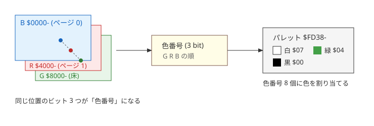
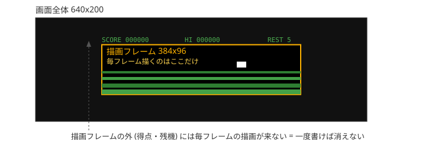
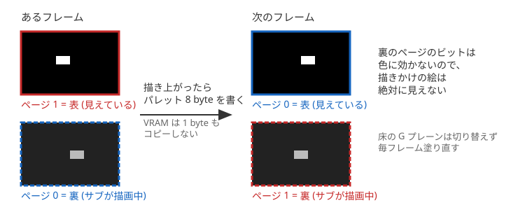
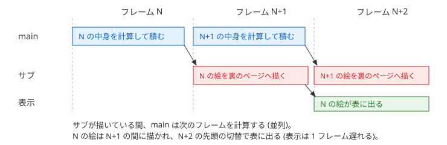
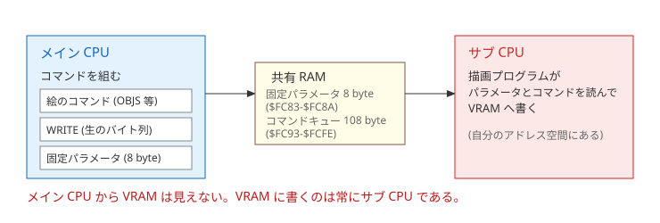

# HorizonRunner — 描画の仕組み

この文書は、HorizonRunner が画面をどう描いているか (3 枚のプレーンと色、画面のどこに描くか、ダブルバッファリング、VRAM への書き込み) を説明する。
各節の図の下に、関係するアドレスとソースの入口を示す。
起動の流れ、メモリマップ、メイン CPU とサブ CPU のやり取りの全体は [ARCHITECTURE.md](ARCHITECTURE.md) を参照のこと。
アドレスは `$1050` のように `$` を付けて 16 進で書く。

## 1. 3 枚のプレーンと色

VRAM (画面のメモリ) はサブ CPU 側にあり、青 (B)・赤 (R)・緑 (G) の 3 プレーンで 1 画面を成す。
プレーンは画面の各 dot に 1 bit ずつを持つ 16 KB のメモリで、同じ位置のビット 3 つが色番号になり、パレットが色を決める。
本作はパレットを「表示中のページのプレーンが 1 なら白、それが 0 で G が 1 なら緑、どちらも 0 なら黒」に設定し、B と R のうち表示中の一方の点だけを白く見せる。



| プレーン | アドレス | 使い方 |
|---|---|---|
| B | `$0000-` | ダブルバッファリングのページ 0。自機・自弾・敵 (白) |
| R | `$4000-` | ダブルバッファリングのページ 1。同上 |
| G | `$8000-` | 床の明るい帯を緑で描く。地平線の行は黒で塗る。切り替えない |

## 2. 画面のどこに描くか

毎フレーム描くのは画面中央の 384x96 dot だけで、この範囲を描画フレームと呼ぶ (時間の単位のフレーム (約 1/60 秒。画面の更新 1 回) とは別の言葉である)。
得点・残機の文字は描画フレームの外に置き、一度書いたら値が変わるまで書き直さない。
ハイスコア (`HI`) も同じ行に置くが、タイトル画面とプレイの開始時に書くだけで、プレイの中では書き直さない。



描画フレームの左上は line 52 / byte 16 (= B プレーンの `$1050`)。

タイトル画面も同じ床を描画フレームの中に毎フレーム流す (`src/c_main.c` の `title_screen()`。帯の組み立てはステージの中と共通)。
タイトルの文字・案内・テンキーの図はすべて描画フレームの外に置くので、床の塗りで消えない。
タイトル画面では絵を貼らないので、ページは B を表に出したまま切り替えない。

## 3. ダブルバッファリング

B と R の 2 ページを交互に使う。
裏のページへ描き切ってから、パレット 8 byte を書いて表裏を入れ替える。



パレットの 2 組は `src/asm_kbd.s` の `pal_b` / `pal_r`。
切替は `palette_page()` がこの 8 byte を `$FD38-` へ書くだけである。

入れ替えを回すのは `src/c_main.c` の `play()` の毎フレーム末尾 4 行。

```c
sub_sync();
palette_page((unsigned char)(1 - page));
sub_flush_async();
page = (unsigned char)(1 - page);
```

順に「前フレームの描き上がりを待つ → そのページを表に出す → 今フレームぶんをサブへ投げる → 描くページを入れ替える」。
サブへは投げるだけで完了を待たないので、メインとサブは並列に働く。



裏のページに残る 2 フレーム前の絵は、サブが自分で消す。
描いた矩形をページごとの表 (`LIST0` / `LIST1`。26 件 = 自機 1 + OBJS の上限 25) に控えておき、そのページが次に選ばれた時に黒へ戻す (`src/asm_subprog.s` の `do_page`)。
メインから消し込みの指示は送らない。

## 4. VRAM への書き込み

メイン CPU から VRAM は見えない。
メインはコマンドの並びを共有 RAM に積むだけで、VRAM に書くのは常にサブ CPU である。
サブ側への転送と呼び出しには、サブ CPU に最初から載っているサブシステム ROM の TEST コマンドを使う (手順は [ARCHITECTURE.md](ARCHITECTURE.md) の「メイン CPU とサブ CPU のやり取り」)。



共有 RAM (メイン `$FC80-$FCFF` / サブ `$D380-$D3FF`) の使い方は次のとおり。

| メイン側 | 中身 |
|---|---|
| `$FC80-$FC82` | TEST コマンドのヘッダ (`$00 $00 $3F`) |
| `$FC83-$FC8A` | **固定パラメータ 8 byte** (下表)。TEST はここを読まないので、描画プログラムへの受け渡しに使う |
| `$FC8B-$FC92` | TEST のサブコマンド (CALL / MOVE) とそのパラメータ |
| `$FC93-$FCFF` | 描画コマンドキュー 108 byte + 終端 1 byte |

固定パラメータは、毎フレームの土台になるもの (描画先のページ、床と地平線、自機) をコマンドにせず決まった並びで置く場所で、その回に処理する項目は flags で指定する (タイトル画面や被弾の演出中は自機を送らない)。
サブは入口で flags を見て、立っているものをキューより先に PAGE → SCENE → SPRITE の順で処理する。

| 位置 | 中身 | 原点と単位 |
|---|---|---|
| +0 | flags。bit7: PAGE 有り / bit6: SCENE 有り / bit5: SPRITE 有り / bit0: 描画先のページ (0 = B / 1 = R) | — |
| +1 | ct (空へ戻す行の先頭) | 描画フレームの上端からの line (偶数) |
| +2 | cn (空へ戻す行数。0 なら消さない) | 描く行の数 (下記の間引き後) |
| +3 | hz (地平線の位置) | 描画フレームの上端からの line (偶数) |
| +4 | n (床の帯の数) | 帯 `[行数, 模様]` x n はキューの先頭に置く。行数は描く行の数、模様は模様表の番号 (0 = 黒、1 = `$AA` の明るい模様) |
| +5 | 自機の x | 画面の左端からの byte 数 (1 byte = 8 dot) |
| +6 | 自機の y | 画面の上端からの line |
| +7 | 自機の横位相 | byte の中での横のずれ (0-7 dot)。8 位相ぶん用意した絵から選ぶ |

床は 1 行おきに描く。
サブ側の床の塗り (`src/asm_subprog.s` の `fill_rows`) は 1 行塗るごとに 2 line 進むので、`cn` と帯の行数は画面上の line 数ではなく描く行の数であり、画面上ではその 2 倍の line に渡る。

キューの並びは `[cmd][params...]` の繰り返しで、終端は `$00` である。
例外は床の帯で、flags の SCENE が立っている時はキューの先頭 n x 2 byte をコマンド ID の無い帯 `[行数, 模様]` x n として読み、その直後から通常のコマンドの並びとして解釈する。
コマンドは 2 系統ある。

1. **絵のコマンド** — サブ側に置いてある絵や模様表を引いて描く。敵・地上物・岩・自弾・爆発 (`$09 OBJS`。1 個 3 byte `[x, y, k|ph<<6]` で、x は画面の左端からの byte 数、y は画面の上端からの line、k は絵の種類の番号、ph は横位相 0-3) と 1 プレーンの表示領域 16,000 byte の消去 (`$01 CLS`。末尾の 384 byte は消さない)。床と地平線、自機は固定パラメータで渡す。
2. **WRITE (`$0A`)** — 送られて来た生のバイト列を、指定アドレスへそのまま書く。メイン側にしか無いデータを VRAM へ置く時に使う。起動時の爆発・敵弾・近距離の敵 B (滞空してから接近する小型の飛行体) の絵の転送と、文字 (字形はメイン側の `build/font.h`) の描画がこれ。

なお、VRAM の読み書きは VRAM ゲート (`$D409`) を開けて行う (描画プログラムが入口で開ける)。
TEST の MOVE は VRAM を転送先に取れないので、起動時の絵の転送も WRITE で行う。
表示オフセットレジスタ (`$D40E/$D40F`) は常に 0 のまま使う。
